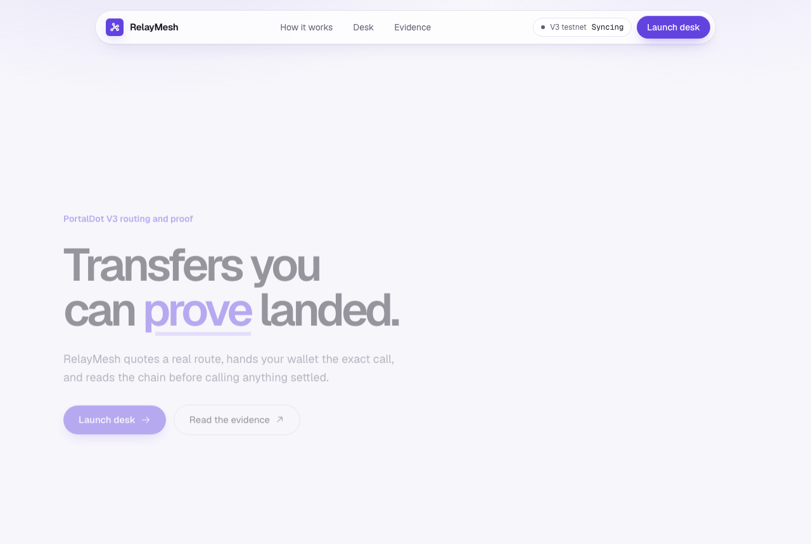
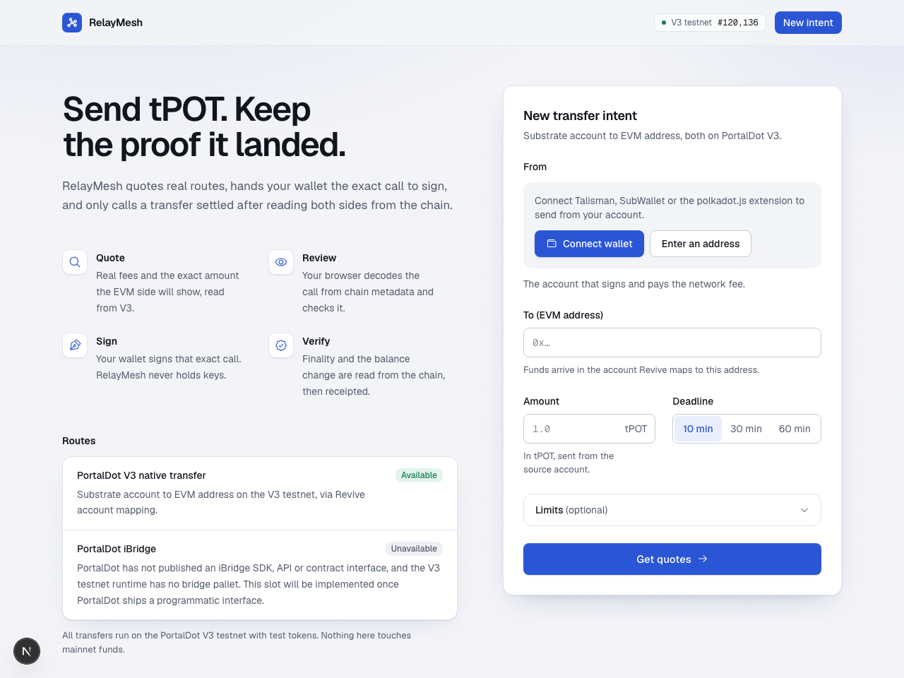
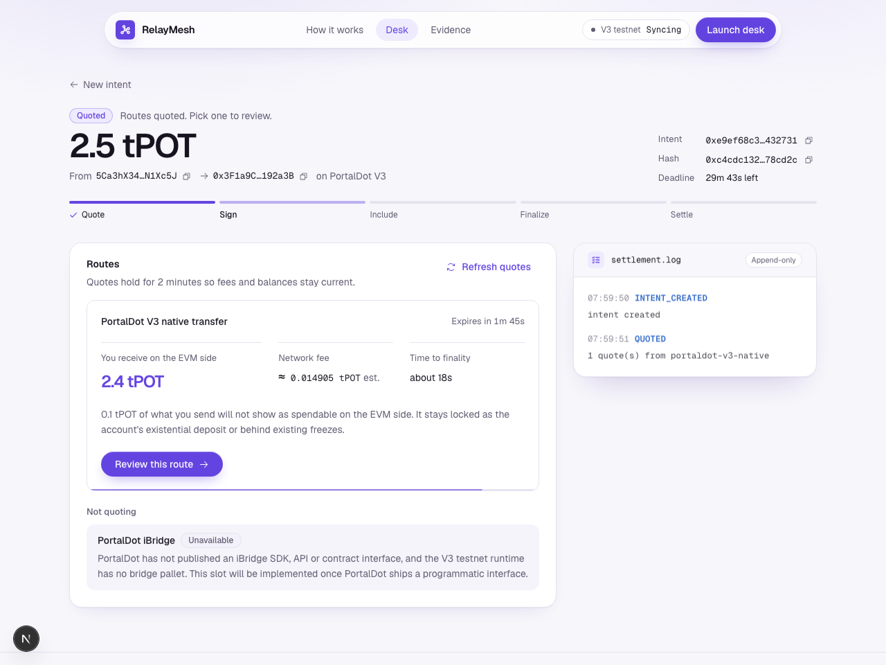
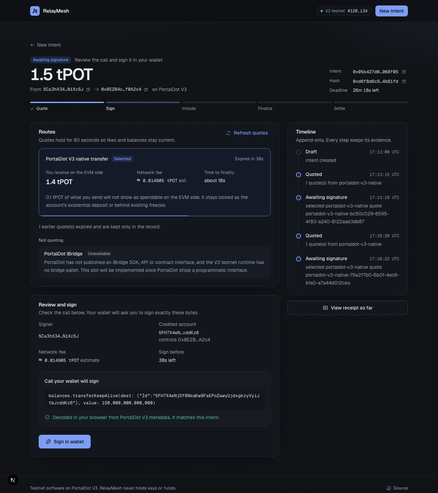
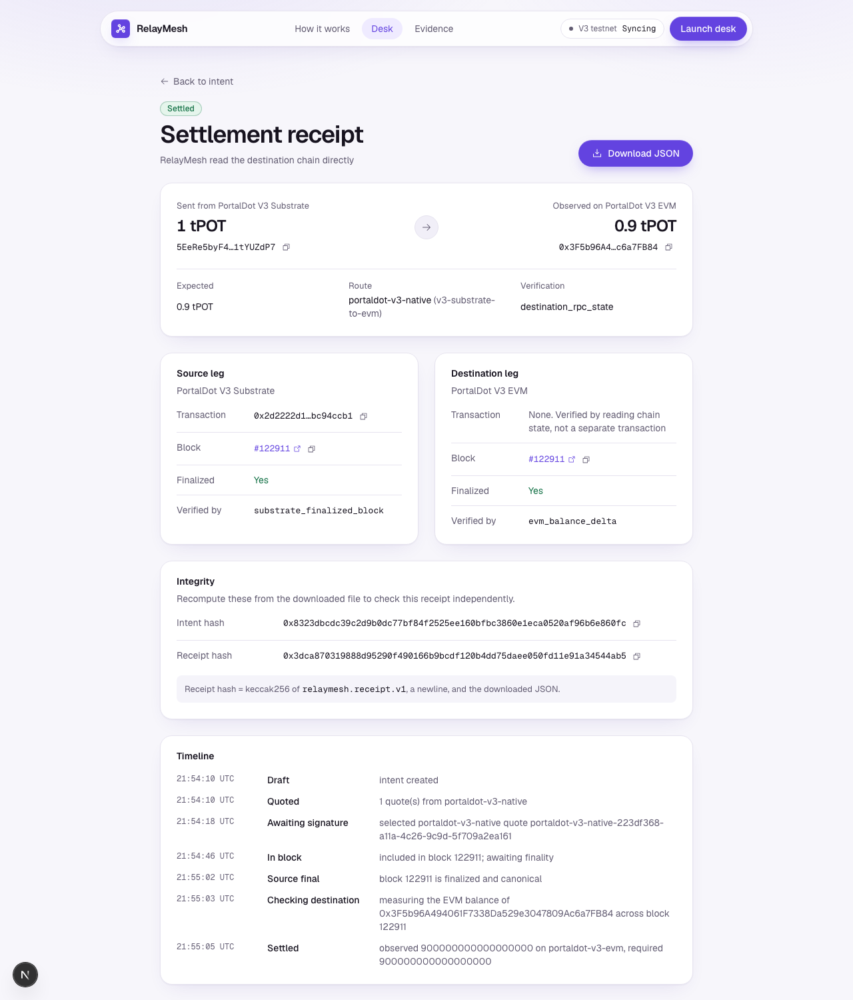
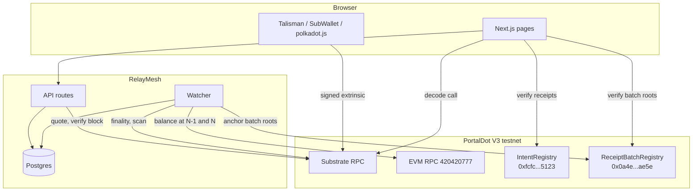
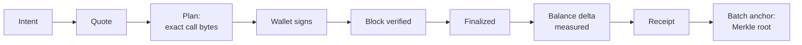

# RelayMesh


**One intent. A verified route. A receipt that proves it landed.**

Moving value between chains usually means trusting a status page that says "completed".
RelayMesh turns a transfer into a structured intent, hands your wallet the exact call to sign, and only calls it settled after reading both sides from the chain itself.
Every step lands in an append-only timeline and ends in a receipt anyone can re-hash.

Live app: [relaymesh.162-62-231-147.sslip.io](https://relaymesh.162-62-231-147.sslip.io) · Watcher: always-on server · Contracts on PortalDot V3 testnet: `IntentRegistry` at `0xfcfc36e3ea951640d1e495a1e671d66c75eb5123`.

[See it in one command](#see-it-in-one-command) · [The one rule](#the-one-rule) · [Architecture](#architecture) · [What's real vs pending](#whats-real-vs-pending---the-honesty-table) · [Tests](#tests) · [Run it locally](#run-it-locally)

Built for the PortalDot V3.0 Hacker House 2026 (Multi-Chain and Cross-Chain Infrastructure track, scope under review with the organizers).
MIT licensed.
RelayMesh is testnet software.
It never holds keys or funds, and it is not a bridge, custodian or financial service.

## Table of contents

- [See it in one command](#see-it-in-one-command)
- [Screenshots](#screenshots)
- [The one rule](#the-one-rule)
- [What RelayMesh does](#what-relaymesh-does)
  - [Structured intents](#structured-intents)
  - [Real quotes, honest rejections](#real-quotes-honest-rejections)
  - [Sign exactly what you reviewed](#sign-exactly-what-you-reviewed)
  - [Settlement from the chain, not a status page](#settlement-from-the-chain-not-a-status-page)
  - [Receipts anyone can re-hash](#receipts-anyone-can-re-hash)
- [Architecture](#architecture)
- [Component by component](#component-by-component)
- [Safety, enforced in code](#safety-enforced-in-code)
- [How it uses PortalDot V3](#how-it-uses-portaldot-v3)
- [Engineering decisions and the hard problems](#engineering-decisions-and-the-hard-problems)
- [What's real vs pending - the honesty table](#whats-real-vs-pending---the-honesty-table)
- [Tests](#tests)
- [Run it locally](#run-it-locally)
- [The one-flow demo](#the-one-flow-demo)
- [Configuration](#configuration)
- [Deploy](#deploy)
- [Project layout](#project-layout)
- [Tech stack, credits, roadmap](#tech-stack-credits-roadmap)
- [Disclaimer and license](#disclaimer-and-license)

## See it in one command

Postgres and the database schema:

```bash
cd RelayMesh
pnpm install && cp .env.example .env && pnpm db:up && pnpm db:migrate
```

The web app and the watcher, in two terminals:

```bash
cd RelayMesh
pnpm --filter @relaymesh/web dev  # http://localhost:3010
```

```bash
cd RelayMesh
pnpm worker  # settlement watcher
```

Open http://localhost:3010 for the landing page, then press Launch desk (or go straight to http://localhost:3010/desk).
Connect Talisman (or enter any PortalDot address to preview quotes without signing), enter an EVM address and an amount, and press Get quotes.
The quote, fee and destination account come from the live PortalDot V3 testnet.

## Screenshots











## The one rule

**Nothing is marked settled unless RelayMesh read it from the chain.**

1. *State machine* - `SETTLED` is only reachable from `DESTINATION_PENDING`, and only with finalized destination-state evidence that carries an observed amount and a verification mode (`packages/core/src/status.ts`).
2. *Server* - a transaction the browser reports is recorded only after the server fetches that block from the node and finds the exact planned call bytes, signed by the requester (`apps/web/src/app/api/intents/[intentId]/source/route.ts`).
3. *Database* - status events, quotes, plans and anchors are append-only by trigger, and every load recomputes the intent hash and replays the full history (`packages/db`).

## What RelayMesh does

### Structured intents

An intent is a validated, normalized request with a 16-byte random ID and a keccak256 hash over canonical JSON.

```text
POST /api/intents   Idempotency-Key: web-...
{ requester, source: { chain, asset, amount }, destination: { chain, asset, recipient }, constraints: { deadline, minOutput?, maxFee? } }
```

Amounts are integer base units end to end, so no value ever passes through a JavaScript float.

### Real quotes, honest rejections

`collectQuotes` asks every route provider in parallel, ranks quotes deterministically, and returns every provider that could not quote with its reason.

```text
portaldot-v3-native   expected 2.4 tPOT (EVM side)   fee ~0.0149 tPOT (payment_queryInfo)   expires 120s
portaldot-ibridge     PROVIDER_UNAVAILABLE: no public SDK, API or contract interface; no bridge pallet in the V3 runtime
```

The expected output follows the chain's real balance rule, including the existential deposit that a new account keeps locked.

### Sign exactly what you reviewed

Selecting a route re-reads chain state, builds a `balances.transferKeepAlive` call, and stores its exact bytes as an execution plan.

```text
balances.transferKeepAlive(dest: 5FH7X4eN...rddKz6, value: 150,000,000,000,000)
Decoded in your browser from PortalDot V3 metadata. It matches this intent.
```

The browser decodes the bytes itself and checks the method, amount and destination before the sign button is enabled.

### Settlement from the chain, not a status page

The watcher confirms the source block is finalized and canonical, then reads `eth_getBalance` for the recipient at the inclusion block and the block before it.

```text
SOURCE_SUBMITTED -> SOURCE_CONFIRMED -> DESTINATION_PENDING -> SETTLED (destination_rpc_state)
                                                            -> NEEDS_REVIEW (short, missing or unmeasurable)
```

It also finds transfers the browser never reported, by scanning finalized blocks for the planned call bytes.

### Receipts anyone can re-hash

Each intent has a receipt view and a canonical JSON download.

```bash
cd RelayMesh
curl -s localhost:3010/api/intents/$INTENT_ID/receipt -D - | grep -i x-receipt-hash
```

`keccak256("relaymesh.receipt.v1\n" + file)` reproduces the hash; this was checked against a real download.

The **Verify** page ([/verify](https://relaymesh.162-62-231-147.sslip.io/verify)) does this in the visitor's browser.
Given an intent ID or a pasted receipt, it hashes the receipt locally and reads the registries straight from the V3 EVM RPC, so the verdict never relies on RelayMesh's server.
Receipts anchored one by one are checked against `IntentRegistry` exactly as before.
For a receipt anchored in a batch, the browser recomputes its leaf, folds the Merkle proof RelayMesh serves up to a root, and checks that root is recorded in `ReceiptBatchRegistry`; a forged proof cannot reach a recorded root, so the proof needs no trust.
It reports whether the receipt matches the chain, does not match (a changed receipt), carries a proof that leads nowhere, or is not anchored yet, and shows the anchoring transaction.

### Batch anchoring

Every settled receipt is committed on chain, but not one write at a time.
Anchoring each intent cost two `IntentRegistry` writes, about 23 tPOT per transfer, almost all of it Revive's storage deposit, and it drained the relayer.
The watcher now collects settled receipts and writes one Merkle root per batch to `ReceiptBatchRegistry`, about 3.9 tPOT whatever the batch size (simulated on V3).
A batch is written when 20 receipts are waiting or the oldest has waited 30 minutes (`ANCHOR_BATCH_SIZE`, `ANCHOR_BATCH_MAX_WAIT_MINUTES`).

- Leaf: `keccak256("relaymesh.batch.leaf.v1\n" + {"intentHash","receiptHash"})`, the same canonical-JSON hashing as receipts.
- Nodes: sorted-pair hashing under `relaymesh.batch.node.v1`, so a proof is just the sibling hashes; leaves and nodes never share a domain.
- Each batch is stored with every leaf and proof before its root is sent, so a crash before or after mining resumes with the same root, read back from the contract.
- The four receipts already in `IntentRegistry` are never re-batched and still verify there.

### Checks for the live PortalDot bridge

The **Bridge** page ([/bridge](https://relaymesh.162-62-231-147.sslip.io/bridge)) checks real transfers through PortalDot's bridge (bridge.portaldot.dev), which takes POT on Portaldot mainnet and pays WPOT on BSC.
Given a deposit's explorer ID, RelayMesh reads the deposit from the Portaldot mainnet node (finalized, successful, into the bridge's deposit address) and searches BSC for the payout: a WPOT transfer from the bridge's reserve, after the deposit, of exactly the deposit less the bridge's 3% fee, in a finalized block, and to the user's BSC address when one is given.
The bridge's own API is never asked.
The bridge does not link its two transactions on chain, so the payout is matched by exact amount, order and optional recipient, and the page says so; a proven deposit with no payout yet is reported as pending, since the bridge pays out in batches hours later.

## Architecture

Two decisions shape everything else.
First, RelayMesh is non-custodial: the server builds unsigned calls and verifies results, and only the user's wallet signs transfers.
Second, chain reads are the source of truth: client reports, provider claims and database rows are all checked against what the node returns.





The full diagrams, including the state machine and a sequence diagram, are in [docs/architecture.md](docs/architecture.md).

| Tier | Runs | Can it move funds? | Responsibility |
| --- | --- | --- | --- |
| Wallet | User's browser extension | Yes, only what the user signs | Signs the planned call |
| Web app | Browser | No | Form, review, call decoding, timeline, receipt |
| API | Node.js (Next.js route handlers) | No | Validation, quotes, plans, inclusion checks |
| Watcher | Node.js process | No user funds; relayer pays for batch writes | Finality, balance measurement, expiry, batch anchoring |
| Postgres | Docker locally | No | Append-only record of everything observed |

## Component by component

### Packages

| Module | Responsibility |
| --- | --- |
| `packages/core/src/intent.ts` | Strict schema, address normalization, deadline window, intent hash |
| `packages/core/src/status.ts` | State machine and evidence rules |
| `packages/core/src/settlement.ts` | Decides settled, pending or needs review; never settles on conflicting evidence |
| `packages/core/src/receipt.ts` | Deterministic receipt, hash and canonical JSON |
| `packages/core/src/merkle.ts` | Batch leaves, sorted-pair Merkle trees, proofs and proof checks |
| `packages/chains/src/substrate-verify.ts` | Reads a block and verifies an extrinsic's call bytes, signer and outcome |
| `packages/chains/src/v3-chain-reader.ts` | Finality, block scanning, timestamps, historical `eth_getBalance` |
| `packages/routes/src/providers/v3-substrate-to-evm.ts` | The live route: mapping, balances, fees, expected output, execution plan |
| `packages/routes/src/providers/ibridge.ts` | iBridge slot that always reports unavailable |
| `packages/db/src/store.ts` | Locked, rule-checked writes for intents, quotes, plans and status |
| `packages/db/src/batch-store.ts` | Planned batches, leaves and proofs (re-checked before storing), mined batch transactions |

### Contracts

| File | Responsibility |
| --- | --- |
| `contracts/src/IntentRegistry.sol` | Records an intent hash and route, then the receipt hash, from the same recorder (per-intent anchoring, before batching) |
| `contracts/src/ReceiptBatchRegistry.sol` | Records one Merkle root per batch of receipts; only the recorder fixed at deployment can write |
| `contracts/test/ReceiptBatchRegistryChecks.sol` | Behaviour checks that run inside one `eth_call` on V3, since its RPC rejects state overrides |
| `contracts/scripts/deploy.ts` | Deploys either contract to V3 and checks the deployed code, immutables included, matches the artifact |

### Apps

| Module | Responsibility |
| --- | --- |
| `apps/web/src/app/api` | Intent, quote, execution, source, receipt and provider endpoints |
| `apps/web/src/components/sign-panel.tsx` | Browser-side call decoding, intent check and wallet signing |
| `apps/worker/src/watcher.ts` | Scan, confirm, measure, expire and batch-anchor stages |
| `apps/web/src/lib/verify-receipt.ts` | In-browser receipt check against `IntentRegistry` or a batch root |

## Safety, enforced in code

| Claim | How it's enforced |
| --- | --- |
| RelayMesh never signs transfers | The API returns unsigned call bytes; signing happens in `signAndSubmit` with the user's extension |
| The wallet signs what the user reviewed | Plan bytes are stored; the browser decodes and checks them; the server only accepts an extrinsic whose bytes equal a stored plan |
| A fake or unrelated transaction cannot advance an intent | Verified live: a made-up block returns 422 `SOURCE_NOT_FOUND`, a real unrelated extrinsic returns 422 `SOURCE_MISMATCH` |
| Settlement needs chain evidence | `SETTLED` requires finalized destination-state evidence with an amount and a verification mode |
| Short or missing deliveries are not hidden | The watcher records the measurement and moves the intent to `NEEDS_REVIEW` |
| History cannot be rewritten | Database triggers block updates and deletes on evidence tables; loads replay the full history |
| Retries cannot double-create intents | Idempotency keys with a request hash; 5 concurrent requests create exactly one intent in tests |
| Stale quotes cannot be signed | Quotes live 120 seconds and are re-checked against live state before a plan is issued |
| Unsigned intents expire safely | Only after the deadline, the signed-transaction lifetime, and a full scan of finalized blocks |

## How it uses PortalDot V3

**Reads**

- Substrate RPC `wss://test-node-v3.portaldot.dev`: balances, existential deposit, `revive.originalAccount`, `revive.nativeToEthRatio`, `payment_queryInfo`, blocks, events, finality, timestamps.
- EVM RPC `https://test-evm-rpc-v3.portaldot.dev` (chain ID 420420777): chain ID check and historical `eth_getBalance`.

**Writes**

- The user's wallet submits `balances.transferKeepAlive` from a Substrate account to the account that controls the target EVM address.
- The watcher's relayer calls `ReceiptBatchRegistry.recordBatch` once per batch of settled receipts, on the deployed contract `0x0a4e4bef58f22a47f28cece57b41ba67dbd5ae5e`.
- Until batching, it called `IntentRegistry.recordIntent` and `recordReceipt` on `0xfcfc36e3ea951640d1e495a1e671d66c75eb5123` after each settlement; those four receipts stay anchored there.

The route uses Revive's account mapping: an EVM address is controlled by its mapped native account or by its fallback account `h160 ++ 0xEE * 12`, and `eth_getBalance` reports that account's reducible balance times 10^4.

## Engineering decisions and the hard problems

**PortalDot's iBridge is not callable yet, so RelayMesh does not pretend it is.**
The PortalDot team confirmed there is no public iBridge SDK, API or contract interface, and the V3 runtime has no bridge pallet.
RelayMesh ships a real route that works today and an iBridge slot that reports exactly why it is unavailable.

**The destination amount is measured, not predicted.**
The quote predicts the EVM-side amount from the chain's balance rule, but settlement reads `eth_getBalance` at the inclusion block and the block before it.
EVM and Substrate block numbers match on V3, so the measurement is tied to the same finalized block.

**The browser is a convenience, not a source of truth.**
A closed tab must not lose a transfer, so the watcher scans finalized blocks for any extrinsic whose bytes equal a stored plan, signed by the requester, and newer than the plan.
That same scan is what makes expiry safe: an awaiting intent only expires after its signing window has been fully scanned.

**Historical state is short-lived on the public node.**
About 1,000 blocks back, `eth_getBalance` fails with "State already discarded".
The watcher classifies this as `state_pruned` and flags the intent instead of guessing.

**Clocks disagree between machines.**
Status times may not go backwards, so a web server clock ahead of the worker could have stalled intents forever.
The watcher never stamps an event earlier than the latest one.

**The remote node is slow from some regions.**
A block fetch took about 1.3 seconds in testing, and bursts of parallel reads timed out after 30 seconds.
The scanner fetches 4 blocks at a time, retries a failed read with backoff, saves its cursor after every chunk, and jumps straight to the blocks where a pending plan could have been signed instead of crawling every block in between.
Those blocks are located from on-chain block timestamps, read from each block's `timestamp.set` inherent, because the node discards state for older blocks but keeps every block.

## What's real vs pending - the honesty table

| Capability | Status |
| --- | --- |
| Intent creation, validation, idempotency | Real - tested and exercised through the live API |
| Quotes with real fees from V3 | Real - `payment_queryInfo` against the live testnet |
| Execution plan and in-browser call decoding | Real - decoded from live V3 metadata |
| Server-side verification of reported transactions | Real - rejection paths verified live against real blocks |
| Watcher finality, scanning and expiry | Real - ran against live V3; expired stale intents correctly |
| Historical `eth_getBalance` delta measurement | Real - measured 0 to 0.9 tPOT across block #122911 for a live transfer |
| A signed tPOT transfer settled end to end | Real - five transfers settled, in blocks #122911, #136917, #172163, #232117 and #238153 ([evidence](docs/evidence.md)) |
| `IntentRegistry` deployment and anchoring | Real - deployed at `0xfcfc36e3ea951640d1e495a1e671d66c75eb5123`; five settled receipts anchored and re-checked against the contract |
| `ReceiptBatchRegistry` batch anchoring | Deployed at `0x0a4e4bef58f22a47f28cece57b41ba67dbd5ae5e` (block #238209); behaviour checked inside an `eth_call` on V3 and run end to end against a local anvil chain. No batch written on V3 yet |
| iBridge cross-chain route | Not yet established - no public interface from PortalDot; confirmed closed to third parties through demo day |
| Checking live PortalDot bridge transfers (POT to BSC) | Real - read-only, verified a 33 POT deposit against its 32.01 WPOT payout on BSC |
| Hosted deployment | Real - web app and watcher on an always-on server behind Caddy, Postgres on Render, serving the same settled transfers and receipts |

The core flow is proven on chain: real signed transfers were quoted, verified, finalized, measured, receipted and anchored in `IntentRegistry` (see [docs/evidence.md](docs/evidence.md)).
What remains is an iBridge route once PortalDot publishes an interface.

## Tests

| Suite | Tests | Covers |
| --- | --- | --- |
| `packages/core` | 62 | Amounts, canonical hashing, intents, state machine, quotes, settlement, idempotency, receipts, Merkle batches and proofs |
| `packages/routes` | 18 | Substrate-to-EVM quoting and plans, iBridge slot, ranking, rejection reporting |
| `packages/chains` | 4 | Revive address mapping |
| `contracts` | 4 | Every source compiles without warnings, committed ABIs are current, the recorder immutable lands where solc says |
| `apps/web` | 17 | In-browser receipt checks against the real anchored receipt: registry and batch matches, tampered receipts, forged proofs |
| `apps/worker` | 12 | Scan ranges, batching configuration and the upgrade path from per-intent anchoring |
| `packages/db` (Postgres) | 23 | Round trips, idempotency races, append-only triggers, plans, concurrency, batch plans and proofs |
| `apps/worker` (Postgres) | 32 | Settlement, forks, short and missing deliveries, pruned state, scanner, expiry, clock skew, batch thresholds, crash recovery, the funds pause |

```bash
cd RelayMesh
pnpm test  # unit tests
pnpm db:up && pnpm test:db  # Postgres integration tests (resets the relaymesh_test database only)
pnpm typecheck && pnpm lint
```

The watcher tests use an in-memory V3 chain and batch registry as test doubles; the database is real.
The contract tests compile every source and check the committed ABIs; `pnpm --filter @relaymesh/contracts simulate:batch-registry` runs the contract's behaviour checks on V3 itself.
The web app has no automated UI tests yet; its flows were verified manually in a browser against the live testnet.

## Run it locally

### 1. Database

```bash
cd RelayMesh
pnpm install
cp .env.example .env
pnpm db:up  # Postgres 17.6 on 127.0.0.1:54329
pnpm db:migrate
```

### 2. Web app

```bash
cd RelayMesh
pnpm --filter @relaymesh/web dev  # http://localhost:3010
```

### 3. Watcher

```bash
cd RelayMesh
pnpm worker
```

### 4. Contract (optional, needs tPOT)

```bash
cd RelayMesh/contracts
pnpm compile
pnpm simulate-deploy  # read-only check against V3
pnpm simulate:batch-registry  # read-only: behaviour checks and costs on V3
pnpm deploy:registry  # needs DEPLOYER_PRIVATE_KEY with tPOT
pnpm deploy:batch-registry  # about 81 tPOT; recorder = BATCH_RECORDER_ADDRESS or the deployer
```

## The one-flow demo

1. Open http://localhost:3010, press Launch desk, and connect Talisman with a funded PortalDot V3 account.
2. Enter an EVM address you control, 1 tPOT, and a 10 minute deadline, then press Get quotes.
3. Review the route: expected EVM-side amount, fee estimate, and the iBridge rejection reason.
4. Press Review this route and check the call your browser decoded.
5. Press Sign in wallet and approve in Talisman.
6. Watch the timeline move from In block to Source final to Settled as the watcher confirms finality and measures the balance change.
7. Open the receipt, download the JSON, and recompute its hash.

## Configuration

### Shared (`.env` at the repository root)

| Variable | Purpose |
| --- | --- |
| `PORTALDOT_V3_WS_URL` | Substrate WebSocket endpoint |
| `PORTALDOT_V3_EVM_RPC_URL` | EVM JSON-RPC endpoint |
| `PORTALDOT_V3_EVM_CHAIN_ID` | Expected EVM chain ID (420420777) |
| `PORTALDOT_V3_EXPLORER_URL` | Block explorer for links (defaults to the official V3 testnet explorer) |
| `DATABASE_URL` | Postgres connection string |
| `TEST_DATABASE_URL` | Postgres database for integration tests (must be named `relaymesh_test`) |

### Watcher

| Variable | Purpose |
| --- | --- |
| `RECEIPT_BATCH_REGISTRY_ADDRESS` | Deployed `ReceiptBatchRegistry`; anchoring is off unless set with the key below. The web app's receipt checker reads it too |
| `RELAYER_PRIVATE_KEY` | EVM key that pays for batch writes; must be the contract's recorder |
| `ANCHOR_BATCH_SIZE` | Write a batch once this many receipts wait (default 20) |
| `ANCHOR_BATCH_MAX_WAIT_MINUTES` | ...or once the oldest has waited this long (default 30) |
| `ANCHOR_BATCH_MAX_LEAVES` | Most receipts in one batch (default 256) |
| `INTENT_REGISTRY_ADDRESS` | `IntentRegistry`, read by the web app's receipt checker for receipts anchored before batching |
| `INTENT_REGISTRY_DEPLOY_BLOCK` | Block that registry was deployed in (136936 on V3); lets the receipt checker show its anchoring transactions |
| `WATCHER_POLL_MS` | Delay between passes (default 6000) |
| `WATCHER_SCAN_BACKFILL_BLOCKS` | First-start scan depth (default 150) |
| `WATCHER_MAX_BLOCKS_PER_PASS` | Scan limit per pass (default 100) |
| `WATCHER_SIGNED_TX_LIFETIME_SECONDS` | Signing window scanned before an awaiting intent expires (default 1800) |

### Contracts

| Variable | Purpose |
| --- | --- |
| `DEPLOYER_PRIVATE_KEY` | EVM key used by `deploy:registry` and `deploy:batch-registry` |
| `BATCH_RECORDER_ADDRESS` | `ReceiptBatchRegistry`'s only writer, fixed at deployment (defaults to the deployer) |

## Deploy

The live deployment runs the web app and the watcher on one small always-on server under PM2, with Postgres on Render.

### Database (Render)

`render.yaml` is a Render Blueprint for Postgres on the free plan in Frankfurt.
From the internet the database accepts only the server's IP, over TLS.
The Blueprint also defines a free Render web service, which serves the same app as a fallback but sleeps when idle.

### Web app (always-on server)

The app is built where memory is plentiful and only the build output is copied to the server, because `next build` needs far more memory than serving does.
On the server, `pm2 start apps/web/ecosystem.config.cjs` serves it on `127.0.0.1:3200`, and Caddy terminates TLS in front of it.
Copy the build into a staging folder next to the live one (for example `.next-staging`), check that its `static`, `server` and `build` file lists match the local ones, then swap it in with one rename and restart.
Copying straight into the live `.next` breaks pages while the copy runs, because `rsync --delete` removes old files first, and Next.js does not serve static files that arrive after it starts.
It uses about 255 MB.
Any other Node.js host that runs `next build` and `next start --port $PORT` works too.

### Watcher (always-on server)

The watcher must run nonstop, so it runs next to the web app under PM2:

```bash
git clone https://github.com/Saber1Y/RelayMesh.git relaymesh && cd relaymesh
corepack pnpm install --frozen-lockfile --filter "@relaymesh/worker..." --filter "@relaymesh/db..."
# .env: DATABASE_URL (external URL with ?sslmode=require), RECEIPT_BATCH_REGISTRY_ADDRESS, RELAYER_PRIVATE_KEY
node --import tsx --env-file=.env packages/db/src/migrate-cli.ts
pm2 start apps/worker/ecosystem.config.cjs && pm2 save
```

It uses about 170 MB once started.
Keep it running: the node only keeps recent historical state, so a long outage can leave transfers unmeasurable (they are flagged, not guessed).
Run only one watcher per relayer key.

### Contract

`pnpm --filter @relaymesh/contracts deploy:batch-registry`, then set `RECEIPT_BATCH_REGISTRY_ADDRESS` for the watcher and the web app, and `RELAYER_PRIVATE_KEY` (the recorder) for the watcher.
A watcher that still has only `INTENT_REGISTRY_ADDRESS` and `RELAYER_PRIVATE_KEY` keeps settling and logs that anchoring is off.

## Project layout

```text
RelayMesh/
  apps/
    web/          # Next.js pages and API routes
    worker/       # settlement watcher
  packages/
    core/         # domain rules, no I/O
    chains/       # PortalDot V3 Substrate and EVM access
    routes/       # route providers and ranking
    db/           # Drizzle schema, migrations, store
  contracts/      # IntentRegistry, ReceiptBatchRegistry, scripts, generated ABIs
  docs/
    architecture.md
    devlog.md     # dated record of every spike and verification
    screenshots/
  docker-compose.yml
```

## Tech stack, credits, roadmap

### Tech stack

TypeScript, pnpm workspaces, Next.js 16, React 19, Tailwind CSS 4, Postgres 17 with Drizzle ORM, `@polkadot/api` and `@polkadot/extension-dapp`, viem, Solidity 0.8 with solc-js, Vitest, zod.

### Credits

PortalDot for the V3 testnet and for confirming the endpoints and the current state of iBridge.
The polkadot.js, viem and Drizzle maintainers.

### Roadmap

- Add the iBridge provider when PortalDot publishes a programmatic interface.
- Add a second route to make ranking meaningful across providers.
- Webhooks for integrators.

## Disclaimer and license

RelayMesh is hackathon software that runs on the PortalDot V3 testnet with test tokens.
It holds no keys or funds, provides no financial advice, and has not been audited.
Do not use it with real assets.

**Licensed under the MIT License, see [LICENSE](LICENSE).**
