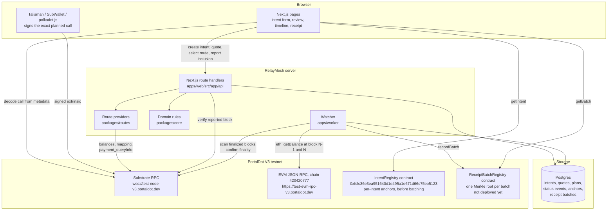
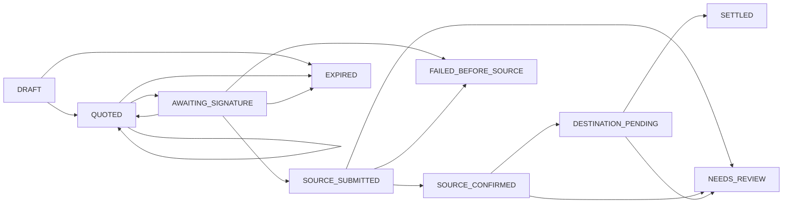
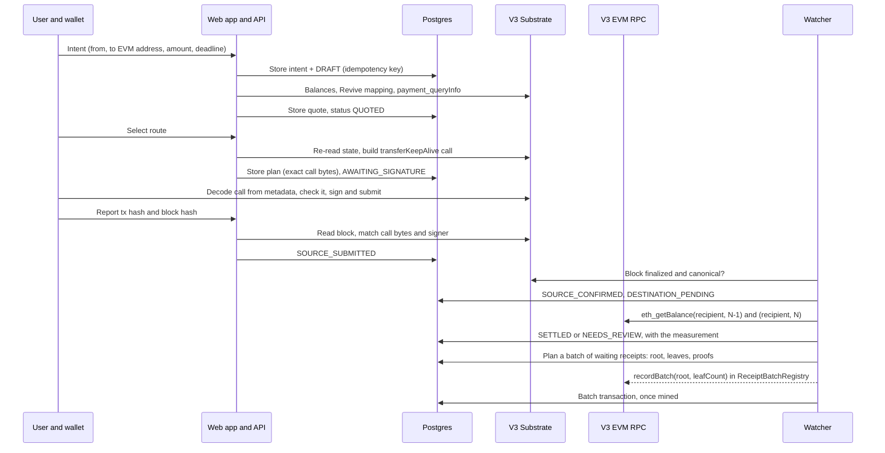

# RelayMesh architecture

This document describes how RelayMesh is built today, on the PortalDot V3 testnet.
Every component named here exists in this repository.
Anything not yet built or not yet verified on chain is called out explicitly.

## System overview

## Intent lifecycle

`SETTLED`, `EXPIRED`, `FAILED_BEFORE_SOURCE` and `NEEDS_REVIEW` are terminal.
Transitions are enforced by `packages/core/src/status.ts` and every stored history is replayed through the same rules when it is loaded.

| Status | Required evidence |
| --- | --- |
| `SOURCE_SUBMITTED` | Source transaction with a transaction hash, read from the chain by the server or the watcher |
| `SOURCE_CONFIRMED` | The same transaction in a finalized, canonical block |
| `SETTLED` | Finalized destination-state evidence with an observed amount, plus a verification mode |

## One transfer, end to end

If the browser never reports the transaction, the watcher still finds it: it scans finalized blocks for extrinsics whose call bytes equal a stored plan, signed by the requester, in a block no older than the plan.

## Packages

| Package | Responsibility |
| --- | --- |
| `packages/core` | Intent schema, canonical hashing, status state machine, quote checks, settlement assessment, idempotency, receipts. No I/O. |
| `packages/chains` | V3 Substrate and EVM clients, Revive address mapping, extrinsic verification, the watcher's chain reader. |
| `packages/routes` | `RouteProvider` interface, the Substrate-to-EVM provider, the iBridge slot (always unavailable), quote ranking. |
| `packages/db` | Drizzle schema and migrations, append-only triggers, store functions that apply core rules in locked transactions. |
| `contracts` | `IntentRegistry` and `ReceiptBatchRegistry` Solidity contracts, compile, simulated deploy, on-chain behaviour checks and deploy scripts, generated typed ABIs. |
| `apps/web` | Next.js pages and API routes. |
| `apps/worker` | Watcher loop: scan, confirm, measure, expire, batch-anchor. |

## Storage

| Table | Mutability | Purpose |
| --- | --- | --- |
| `intents` | Terms immutable (trigger); only `current_status` and `selected_quote_id` change | The signed-off request and its hash |
| `status_events` | Append-only (trigger) | Source of truth for status, with evidence |
| `quotes` | Append-only (trigger) | Every quote ever shown |
| `execution_plans` | Append-only (trigger) | The exact call bytes handed to the wallet |
| `idempotency_records` | Append-only (trigger) | Request hash per idempotency key |
| `registry_anchors` | Append-only (trigger) | IntentRegistry writes from before batching, inserted only after mining |
| `receipt_batches` | Append-only (trigger) | A planned batch: contract, Merkle root, leaf count; written before the root is sent |
| `receipt_batch_leaves` | Append-only (trigger) | Each intent's leaf, receipt hash and proof; one batch per intent per contract |
| `receipt_batch_anchors` | Append-only (trigger) | A batch's mined `recordBatch` transaction |
| `watcher_cursors` | Forward-only | Last finalized block scanned |

## Trust boundaries

- The browser is never trusted for facts.
  A reported transaction is accepted only after the server reads the block from the node and finds the exact planned call signed by the requester.
- Route providers are not trusted for settlement.
  Settlement comes from RelayMesh's own `eth_getBalance` reads at a finalized block.
- The database is not trusted blindly.
  Each load recomputes the intent hash and replays the full status history.
- `IntentRegistry` and `ReceiptBatchRegistry` are audit anchors only.
  They prove which hashes the relayer committed to, not that a transfer happened.
- RelayMesh's batch proofs are not trusted.
  The receipt checker recomputes the leaf from the receipt in hand and accepts it only if the proof folds to a root the contract has recorded.

## Batch anchoring

Settled receipts are anchored in batches: one `ReceiptBatchRegistry.recordBatch(root, leafCount)` covers many intents.

| Part | Choice |
| --- | --- |
| Leaf | `hashCanonical("relaymesh.batch.leaf.v1", { intentHash, receiptHash })`, the receipts' own canonical-JSON hashing |
| Node | `hashCanonical("relaymesh.batch.node.v1", [a, b])` with `a <= b` (sorted pairs), so a proof is only sibling hashes |
| Leaf order | Sorted ascending and unique, so the root depends only on the set of leaves |
| Odd node | Carried up unchanged, never duplicated |
| When | `ANCHOR_BATCH_SIZE` receipts waiting (20), or the oldest settled `ANCHOR_BATCH_MAX_WAIT_MINUTES` ago (30), at most `ANCHOR_BATCH_MAX_LEAVES` per batch (256) |
| Cost | About 3.9 tPOT per batch on V3 (simulated), against about 23 tPOT per intent before |

Recovery follows the same rule as before batching: read the chain, then record.
A batch is stored with all its leaves and proofs before its root is sent.
On the next pass, an unconfirmed batch's root is read back with `getBatch`; if it is recorded, its `BatchRecorded` event is looked up in exactly the block the contract stored, and otherwise the same root is sent again.
Receipts that settle in the meantime go to the next batch, so a crash never changes a root after it may have been mined.

The contract stores one slot per batch (recorded time, block number, leaf count) and fixes its recorder at deployment.
`IntentRegistry` is no longer written; the receipts anchored there are never re-batched, and the receipt checker reads it first, so they verify exactly as before.

## Known limits

- The only route is Substrate to EVM within PortalDot V3.
  iBridge has no public interface and the V3 runtime has no bridge pallet (checked 2026-10-20).
- The V3 node keeps historical state for recent blocks only.
  If the watcher is down for more than about 25 minutes after a transfer, the balance delta can no longer be measured and the intent is flagged for review.
- Two signed transfers have settled end to end so far (blocks #122911 and #136917, see [evidence.md](evidence.md)); broader testing is still to come.
- `IntentRegistry` is deployed at `0xfcfc36e3ea951640d1e495a1e671d66c75eb5123` with a single recorder, the RelayMesh relayer key, and holds the four receipts anchored before batching.
- `ReceiptBatchRegistry` is not deployed yet (about 82 tPOT); until it is, the watcher settles transfers with anchoring off.
  Anchoring pauses if the relayer runs out of tPOT; settlement does not depend on it.
