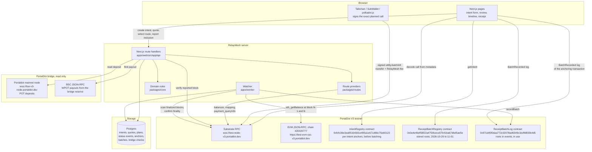
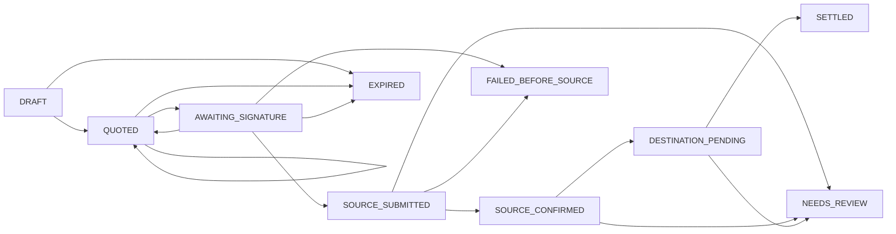
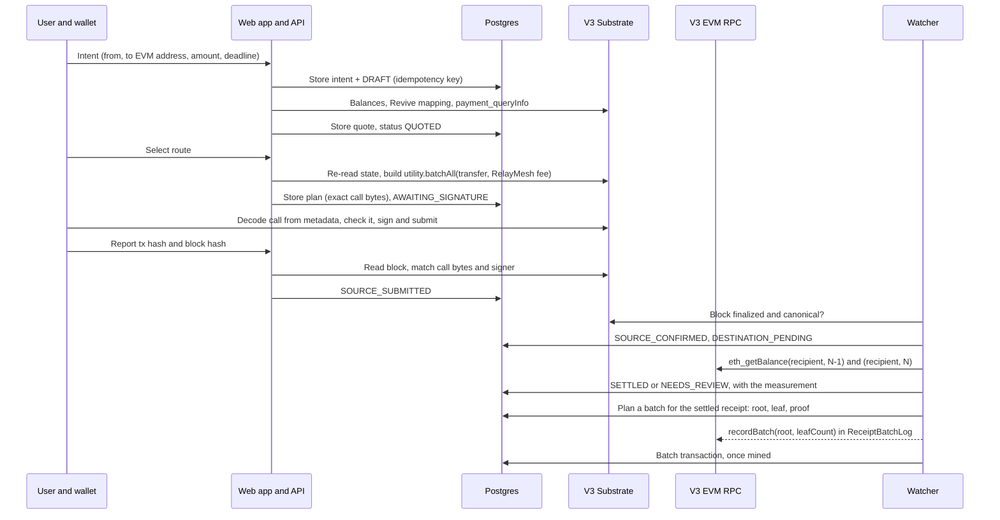

# RelayMesh architecture

This document describes how RelayMesh is built today, on the PortalDot V3 testnet.
Every component named here exists in this repository.
Anything not yet built or not yet verified on chain is called out explicitly.

## System overview

## Intent lifecycle

`SETTLED`, `EXPIRED`, `FAILED_BEFORE_SOURCE` and `NEEDS_REVIEW` are terminal.
Transitions are enforced by `packages/core/src/status.ts` and every stored history is replayed through the same rules when it is loaded.

| Status | Required evidence |
| --- | --- |
| `SOURCE_SUBMITTED` | Source transaction with a transaction hash, read from the chain by the server or the watcher |
| `SOURCE_CONFIRMED` | The same transaction in a finalized, canonical block |
| `SETTLED` | Finalized destination-state evidence with an observed amount, plus a verification mode |

## One transfer, end to end

If the browser never reports the transaction, the watcher still finds it: it scans finalized blocks for extrinsics whose call bytes equal a stored plan, signed by the requester, in a block no older than the plan.

## Packages

| Package | Responsibility |
| --- | --- |
| `packages/core` | Intent schema, canonical hashing, status state machine, quote checks and the service fee, settlement assessment, idempotency, receipts, Merkle batches, bridge assessment. No I/O. |
| `packages/chains` | V3 Substrate and EVM clients, Revive address mapping, extrinsic verification, the watcher's chain reader, bridge deposit and payout reads. |
| `packages/routes` | `RouteProvider` interface, the Substrate-to-EVM provider, the iBridge slot (always unavailable), quote ranking. |
| `packages/db` | Drizzle schema and migrations, append-only triggers, store functions that apply core rules in locked transactions. |
| `contracts` | `IntentRegistry`, `ReceiptBatchRegistry` and `ReceiptBatchLog` Solidity contracts, compile, simulated deploy, on-chain behaviour checks and deploy scripts, generated typed ABIs. |
| `apps/web` | Next.js pages (landing, Desk, Verify, Bridge, Developers) and API routes. |
| `apps/worker` | Watcher loop: scan, confirm, measure, expire, anchor receipts and bridge checks. |

## Storage

| Table | Mutability | Purpose |
| --- | --- | --- |
| `intents` | Terms immutable (trigger); only `current_status` and `selected_quote_id` change | The signed-off request and its hash |
| `status_events` | Append-only (trigger) | Source of truth for status, with evidence |
| `quotes` | Append-only (trigger) | Every quote ever shown |
| `execution_plans` | Append-only (trigger) | The exact call bytes handed to the wallet |
| `idempotency_records` | Append-only (trigger) | Request hash per idempotency key |
| `registry_anchors` | Append-only (trigger) | IntentRegistry writes from before batching, inserted only after mining |
| `receipt_batches` | Append-only (trigger) | A planned batch: contract, Merkle root, leaf count; written before the root is sent |
| `receipt_batch_leaves` | Append-only (trigger) | Each intent's leaf, receipt hash and proof; one batch per intent per contract |
| `receipt_batch_anchors` | Append-only (trigger) | A batch's mined `recordBatch` transaction |
| `bridge_checks` | Append-only (trigger) | A verified bridge transfer: deposit, payout and the facts its fingerprint hashes |
| `bridge_batch_leaves` | Append-only (trigger) | Each bridge check's leaf and proof in a batch |
| `watcher_cursors` | Forward-only | Last finalized block scanned |

## Trust boundaries

- The browser is never trusted for facts.
  A reported transaction is accepted only after the server reads the block from the node and finds the exact planned call signed by the requester.
- Route providers are not trusted for settlement.
  Settlement comes from RelayMesh's own `eth_getBalance` reads at a finalized block.
- The database is not trusted blindly.
  Each load recomputes the intent hash and replays the full status history.
- `IntentRegistry`, `ReceiptBatchRegistry` and `ReceiptBatchLog` are audit anchors only.
  They prove which hashes the relayer committed to, not that a transfer happened.
- RelayMesh's batch proofs are not trusted.
  The checkers recompute the leaf from the receipt or bridge facts in hand and accept it only if the proof folds to a root in a `BatchRecorded` log of the anchoring transaction, emitted by one of RelayMesh's own contracts, named in the page's configuration rather than by the API.
- The PortalDot bridge is not trusted.
  A bridge check reads the deposit from the Portaldot mainnet node and the payout from BSC; the bridge's own API is never asked.

## Anchoring

Settled receipts and verified bridge checks are anchored as Merkle roots, one `recordBatch(root, leafCount)` per batch.

| Part | Choice |
| --- | --- |
| Receipt leaf | `hashCanonical("relaymesh.batch.leaf.v1", { intentHash, receiptHash })`, the receipts' own canonical-JSON hashing |
| Bridge leaf | `hashCanonical("relaymesh.batch.bridge.v1", { checkHash })`, over the check's fingerprint of the deposit and payout facts |
| Node | `hashCanonical("relaymesh.batch.node.v1", [a, b])` with `a <= b` (sorted pairs), so a proof is only sibling hashes |
| Leaf order | Sorted ascending and unique, so the root depends only on the set of leaves |
| Odd node | Carried up unchanged, never duplicated |
| When | With `ReceiptBatchLog`: as soon as one entry waits (`ANCHOR_BATCH_SIZE` 1); with `ReceiptBatchRegistry`: 20 entries or 30 minutes; at most 256 per batch |
| Cost | `ReceiptBatchLog` 0.0186 tPOT per write, measured; `ReceiptBatchRegistry` 3.86 tPOT; `IntentRegistry` about 23 tPOT per intent |

`ReceiptBatchLog` emits the root in a `BatchRecorded` event and stores nothing, which skips Revive's storage deposit, almost all of the older contracts' cost.
`ReceiptBatchRegistry` emits the same event and also stores the root, so the checkers read both the same way, from the anchoring transaction's receipt.

Recovery follows one rule: read the chain, then record.
A batch is stored with all its leaves and proofs before its root is sent.
On the next pass, an unconfirmed batch's `BatchRecorded` event is searched for over the last 5,000 blocks; if found, its transaction is recorded, and otherwise the same root is sent again.
Entries that settle in the meantime go to the next batch, so a crash never changes a root after it may have been mined.
Nothing is anchored twice: entries already anchored in `IntentRegistry` or `ReceiptBatchRegistry` stay there and still verify.

## The RelayMesh fee

Each transfer pays a fee (`RELAYMESH_FEE`, 0.2 tPOT live) to the account behind `RELAYMESH_FEE_RECIPIENT`, the relayer, in the same signed call: `utility.batchAll` of the transfer and the fee, so both happen or neither does.
The quote lists it as a `provider` fee with its recipient, it counts against `maxFee`, the browser checks the bundled call before signing, and the receipt records it as `serviceFee`, so it is inside the anchored hash.
Receipts without a fee have no such field and hash exactly as before.
At 0.0186 tPOT per anchor, one fee pays for about ten.

## Bridge checks

A bridge check reads a POT deposit on Portaldot mainnet (finalized, successful, into the bridge's deposit address) and searches BSC for a WPOT transfer from the bridge's reserve of exactly the deposit less the 3% fee, after the deposit, in a finalized block.
The bridge does not link the two transactions, so the first such payout after the deposit is the match, optionally pinned to a recipient.

- The search starts at the first BSC block at or after the deposit, found from block timestamps.
- Each 50,000-block log search is sent six times at once, in up to four rounds, and counts as empty only when every attempt is: the public BSC endpoint answers many older searches with nothing, and a missed range could match a later payout of the same amount.
- Ranges are searched three at a time, in order, and the earliest range with a match decides.
- A verified check is stored append-only with the facts it hashes, then anchored like a receipt; a later check of the same deposit re-reads the recorded payout transaction instead of searching.

## Known limits

- The only route is Substrate to EVM within PortalDot V3.
  iBridge has no public interface and the V3 runtime has no bridge pallet (checked 2026-10-20).
- The V3 node keeps historical state for recent blocks only.
  If the watcher is down for more than about 25 minutes after a transfer, the balance delta can no longer be measured and the intent is flagged for review.
- Ten signed transfers have settled end to end so far, 382 tPOT in all (see [evidence.md](evidence.md)); volume is still testnet-sized.
- `IntentRegistry` is deployed at `0xfcfc36e3ea951640d1e495a1e671d66c75eb5123` with a single recorder, the RelayMesh relayer key, and holds the five receipts anchored before batching.
- `ReceiptBatchRegistry` is deployed at `0x0a4e4bef58f22a47f28cece57b41ba67dbd5ae5e` (block #238209) and holds 3 batches; `ReceiptBatchLog` is deployed at `0x971d45f0daa772c02078ad6349c1bcffd833b4d5` (block #277373) and takes everything new. Both have the same recorder.
  A watcher with neither address set settles transfers with anchoring off.
  Anchoring pauses if the relayer runs out of tPOT; settlement does not depend on it.
- A first bridge check of a deposit the bridge paid days later can take one to two and a half minutes, because of the repeated BSC searches; re-checks take about a second.
