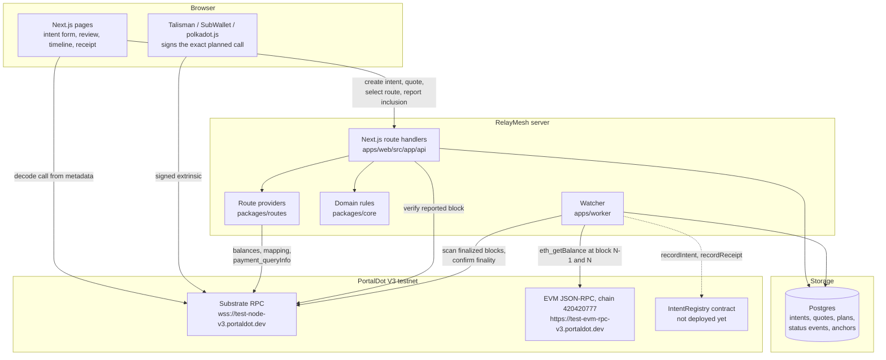
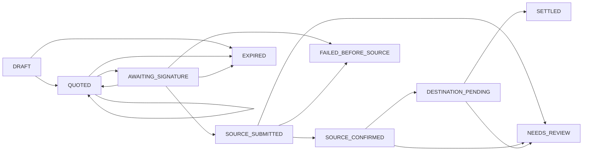
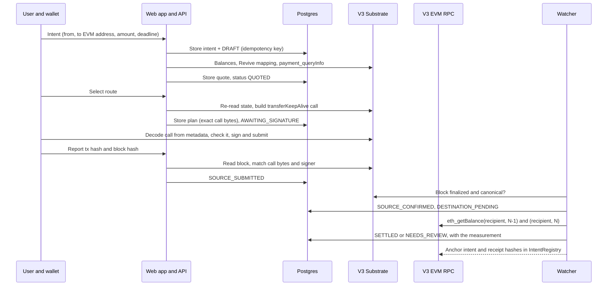

# RelayMesh architecture

This document describes how RelayMesh is built today, on the PortalDot V3 testnet.
Every component named here exists in this repository.
Anything not yet built or not yet verified on chain is called out explicitly.

## System overview

Dashed edges are implemented but not yet exercised on chain.

## Intent lifecycle

`SETTLED`, `EXPIRED`, `FAILED_BEFORE_SOURCE` and `NEEDS_REVIEW` are terminal.
Transitions are enforced by `packages/core/src/status.ts` and every stored history is replayed through the same rules when it is loaded.

| Status | Required evidence |
| --- | --- |
| `SOURCE_SUBMITTED` | Source transaction with a transaction hash, read from the chain by the server or the watcher |
| `SOURCE_CONFIRMED` | The same transaction in a finalized, canonical block |
| `SETTLED` | Finalized destination-state evidence with an observed amount, plus a verification mode |

## One transfer, end to end

If the browser never reports the transaction, the watcher still finds it: it scans finalized blocks for extrinsics whose call bytes equal a stored plan, signed by the requester, in a block no older than the plan.

## Packages

| Package | Responsibility |
| --- | --- |
| `packages/core` | Intent schema, canonical hashing, status state machine, quote checks, settlement assessment, idempotency, receipts. No I/O. |
| `packages/chains` | V3 Substrate and EVM clients, Revive address mapping, extrinsic verification, the watcher's chain reader. |
| `packages/routes` | `RouteProvider` interface, the Substrate-to-EVM provider, the iBridge slot (always unavailable), quote ranking. |
| `packages/db` | Drizzle schema and migrations, append-only triggers, store functions that apply core rules in locked transactions. |
| `contracts` | `IntentRegistry` Solidity contract, compile, simulated deploy and deploy scripts, generated typed ABI. |
| `apps/web` | Next.js pages and API routes. |
| `apps/worker` | Watcher loop: scan, confirm, measure, expire, anchor. |

## Storage

| Table | Mutability | Purpose |
| --- | --- | --- |
| `intents` | Terms immutable (trigger); only `current_status` and `selected_quote_id` change | The signed-off request and its hash |
| `status_events` | Append-only (trigger) | Source of truth for status, with evidence |
| `quotes` | Append-only (trigger) | Every quote ever shown |
| `execution_plans` | Append-only (trigger) | The exact call bytes handed to the wallet |
| `idempotency_records` | Append-only (trigger) | Request hash per idempotency key |
| `registry_anchors` | Append-only (trigger) | IntentRegistry writes, inserted only after mining |
| `watcher_cursors` | Forward-only | Last finalized block scanned |

## Trust boundaries

- The browser is never trusted for facts.
  A reported transaction is accepted only after the server reads the block from the node and finds the exact planned call signed by the requester.
- Route providers are not trusted for settlement.
  Settlement comes from RelayMesh's own `eth_getBalance` reads at a finalized block.
- The database is not trusted blindly.
  Each load recomputes the intent hash and replays the full status history.
- `IntentRegistry` is an audit anchor only.
  It proves which hashes the relayer committed to, not that a transfer happened.

## Known limits

- The only route is Substrate to EVM within PortalDot V3.
  iBridge has no public interface and the V3 runtime has no bridge pallet (checked 2026-10-20).
- The V3 node keeps historical state for recent blocks only.
  If the watcher is down for more than about 25 minutes after a transfer, the balance delta can no longer be measured and the intent is flagged for review.
- No signed transfer has run yet, because no testnet tPOT has been received.
- `IntentRegistry` is not deployed yet (about 96 tPOT estimated).
